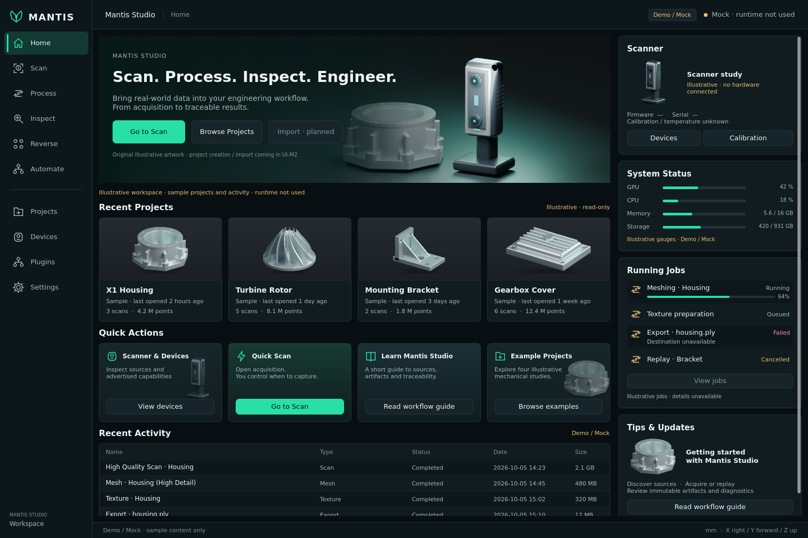
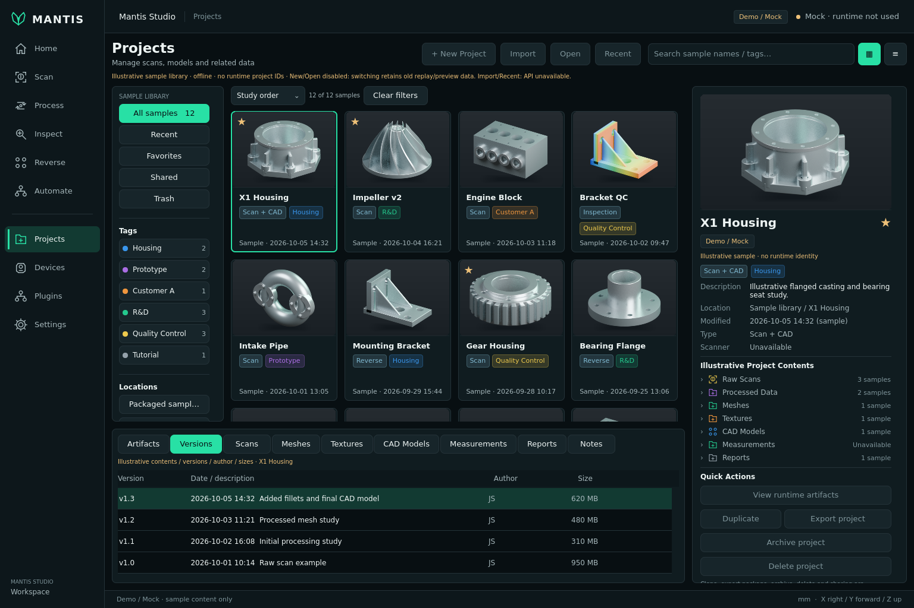
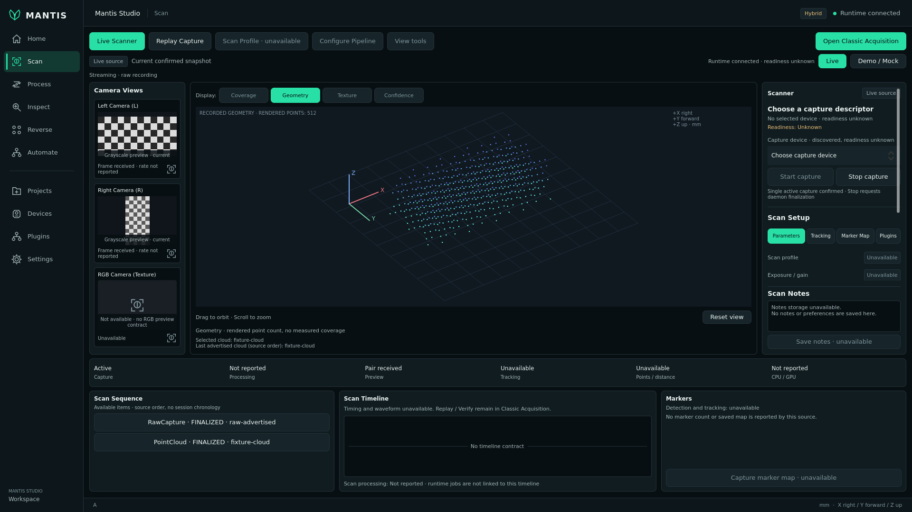
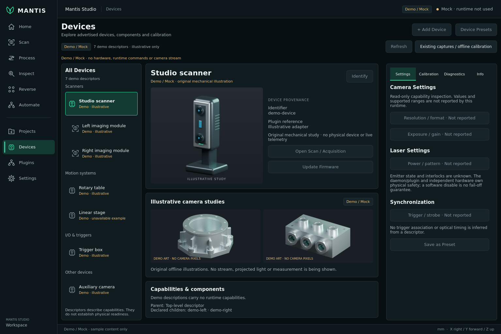

[](https://github.com/martinkoenig/mantis-studio/actions/workflows/build.yml)
[](LICENSE)
[](https://isocpp.org/)

# Mantis Studio

**An open-source, modular 3D-scanning software platform, developed alongside the Mantis X1 handheld laser-scanner project.**

Mantis Studio is a C++23/Qt 6 application and runtime for hardware acquisition, calibration, reproducible data processing and 3D visualization. It is designed around a device-owning daemon, extensible plugins and independent desktop, CLI and SDK clients. Linux/ARM64 acquisition on the Radxa Q6A is a first-class development target.

> **Development status:** This is an engineering project, **not a finished or accuracy-certified 3D scanner**. `main` contains the accepted **v0.2 acquisition foundation**. Geometric calibration, projected-light acquisition and the redesigned desktop interface are under active development on separate feature branches. The UI screenshots below show that newer UI branch, **not the UI built from `main`**.

## Mantis Studio — UI preview



*Home workspace, captured from the running Qt application in explicitly labelled **Demo / Mock** mode. The scanner artwork, sample projects, utilization and jobs are illustrative; they are not hardware measurements.*

| Projects | Scan |
| :---: | :---: |
|  |  |
| Project gallery and inspector (**Demo / Mock**) | Scan workspace with two grayscale previews and a rendered test point cloud (**authenticated fixture**, no physical scanner) |

<details>
<summary>Additional screenshot — Devices</summary>



*Devices workspace with explicitly labelled illustrative device descriptors. No physical hardware or laser state is shown.*

</details>

All four images are **actual Qt window captures**, not conceptual UI renders, from [`feature/ui-m3-scan`](https://github.com/martinkoenig/mantis-studio/tree/feature/ui-m3-scan) at [revision `f5fefe7`](https://github.com/martinkoenig/mantis-studio/commit/f5fefe759f1cfb892604e6e3147656058f7ef2ec). The Scan image uses a deterministic authenticated client/daemon test fixture; its geometry, camera frames and capture state are **not real-world scanning results**. The separate [UI implementation and validation notes](https://github.com/martinkoenig/mantis-studio/blob/feature/ui-m3-scan/docs/ui/README.md) document which controls and workflows are implemented.

## Architecture and engineering focus

| Area | Design |
| --- | --- |
| **Runtime & clients** | `mantisd` owns devices, captures, plugins, artifacts and jobs. Qt Quick Studio, the C++ CLI and Python SDK interact through public client/protocol boundaries. |
| **Acquisition** | Linux media/V4L2 dual-camera integration for OV9281 sensors on the X1/Q6A, explicit device profiles, bounded frame correspondence and traceable FrameSets. |
| **Data integrity** | Immutable typed artifacts, bounded queues with separate lossless recording and latest-only preview policies, recoverable segmented recording and deterministic replay/verification. |
| **Processing & extensibility** | Versioned pipeline recipes, plugin interfaces, asynchronous jobs and cancellable operations; scanner-specific hardware stays behind runtime contracts. |
| **UI & visualization** | Dark Qt Quick workspace with device/project inspection, stereo previews and point-cloud visualization. New UI features are staged on a dedicated branch. |
| **Verification** | Automated native Linux x86_64/ARM64 CI, process and protocol tests, deterministic hardware-free fixtures and separately documented physical-hardware acceptance. |

The guiding principle is to **separate acquisition, processing, presentation and hardware control**. A desktop client closing must not implicitly terminate an active daemon capture. Runtime failures and incomplete evidence should be reported rather than converted into misleading UI success states.

## Development tracks

These tracks are intentionally developed in parallel. Their presence in a feature branch does **not** mean they have been integrated into `main` or physically validated.

| Track | Current boundary | Source |
| --- | --- | --- |
| **v0.2 — acquisition foundation** | Accepted and merged into `main`: Q6A dual-camera capture, bounded recording and deterministic replay, including documented real-hardware validation. | [`main`](https://github.com/martinkoenig/mantis-studio/tree/main) |
| **v0.3 — geometric calibration** | Geometric calibration foundations and Studio workflow; physical acceptance remains a separate gate. | [Calibration branch](https://github.com/martinkoenig/mantis-studio/tree/feature/v0.3-geometric-calibration) |
| **v0.4 — projected-light acquisition** | Laser-control semantics, safe-state and timing/evidence infrastructure under development. Physical laser operation and full reconstruction are not implied. | [Laser-acquisition branch](https://github.com/martinkoenig/mantis-studio/tree/feature/v0.4-laser-acquisition) |
| **Desktop UI** | Home, Projects, Devices and Scan workspace development, including mock/live source separation and tested integration boundaries. | [UI branch](https://github.com/martinkoenig/mantis-studio/tree/feature/ui-m3-scan) |

**Not yet delivered as a complete scanner workflow:** production laser-line extraction, metric laser triangulation, moving-scan registration/fusion, meshing and independently verified dimensional accuracy. See the [active roadmap](https://github.com/martinkoenig/mantis-studio/blob/feature/v0.4-laser-acquisition/ROADMAP.md) for planned milestones, accepted packages and outstanding hardware validation.

## Build and run the `main` foundation

See [BUILDING.md](BUILDING.md) for dependencies, platforms and build instructions. After building into `build/debug`, start the daemon and Studio **with the same endpoint and token**:

```bash
export MANTIS_TOKEN="$(python3 -c 'import secrets; print(secrets.token_hex(24))')"
export MANTIS_PORT=47321
./build/debug/bin/mantisd --project "$PWD/Demo.mantis" &
./build/debug/bin/mantis-studio
```

The CLI and Python examples use the same runtime:

```bash
./build/debug/bin/mantis-cli devices list
./build/debug/bin/mantis-cli workflow "$PWD/example.ply"
PYTHONPATH=build/debug/python /usr/bin/python3 examples/python/workflow.py python-example.ply
./build/debug/bin/mantis-cli shutdown
```

Closing the desktop window does **not** stop `mantisd` or an active capture. Stop capture before issuing `mantis-cli shutdown`. Export paths must be new and outside the `.mantis` project directory.

### Real X1 acquisition (`main`)

The v0.2 plugin uses explicit LEFT/RIGHT roles and a versioned Q6A profile. It supports packed Y10P/RAW10 and optional RAW8 capture with recoverable RawCapture v2 segments, bounded FrameSet recording, latest-only preview and replay verification. The accepted Q6A reference profile uses **1280×720 Y10P** with a requested **120 FPS** target; requested rate, measured rate and physical exposure synchronization are distinct claims.

```bash
# Configure the profile in the daemon environment BEFORE starting mantisd.
export MANTIS_X1_PROFILE="$PWD/profiles/x1-q6a.json"
./build/debug/bin/mantis-cli devices list
./build/debug/bin/mantis-cli devices info DEVICE_ID
./build/debug/bin/mantis-cli capture start DEVICE_ID
./build/debug/bin/mantis-cli capture status CAPTURE_ID
./build/debug/bin/mantis-cli capture stop CAPTURE_ID
./build/debug/bin/mantis-cli captures list
./build/debug/bin/mantis-cli replay verify RAW_ARTIFACT_ID
```

Review the real camera/bus/entity assignments in the profile before use. Without an explicit profile there is no assumed physical camera role. `MANTIS_X1_FAKE=normal` is **test-only**; its fixture data is never hardware acceptance evidence. The accepted Q6A harness validated a 5 ms software correspondence policy and deterministic replay; hardware synchronization, optical exposure skew, sustained external-storage throughput and some crash-recovery scenarios require separate evidence. See the [real acquisition validation procedure](docs/hardware/x1-q6a-acquisition-validation.md) and [v0.2 review](docs/architecture/v0.2-acquisition-review.md).

## Technical documentation

- [Architecture specification](MANTIS_STUDIO_ARCHITECTURE.md) and [implementation map](docs/architecture/implementation.md)
- [Plugin development](docs/plugin-development/README.md) and [C++ / Python client SDK](docs/client-sdk/README.md)
- [Protocol / local data plane](docs/protocol/README.md) and [storage / recovery](docs/architecture/storage.md)
- [Architecture Decision Records](docs/adr/README.md)
- [Milestone coverage](docs/architecture/milestone.md) and [validation evidence](docs/architecture/validation.md)
- [Contributing](CONTRIBUTING.md), [security](SECURITY.md) and [Apache-2.0 license](LICENSE)

**Platform scope:** Linux x86_64 and ARM64 have validated foundation builds/tests; Q6A-specific hardware claims are limited to their recorded acceptance evidence. Windows x86_64 and macOS ARM64 are architectural targets, **not supported releases** of this development snapshot.
