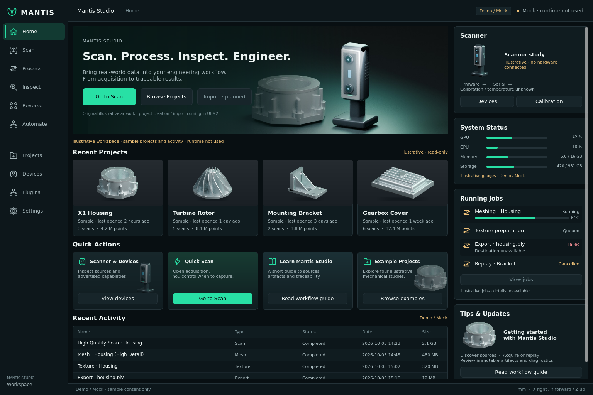
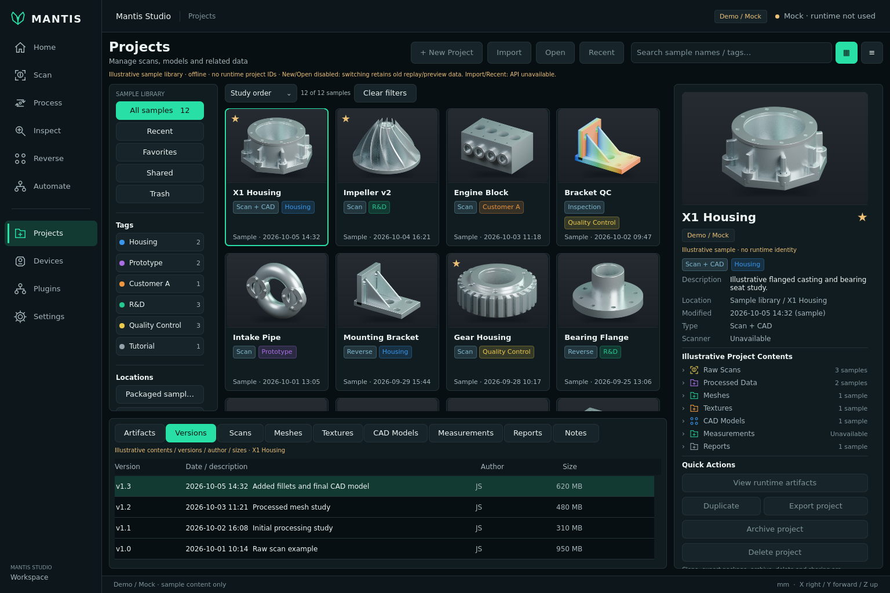
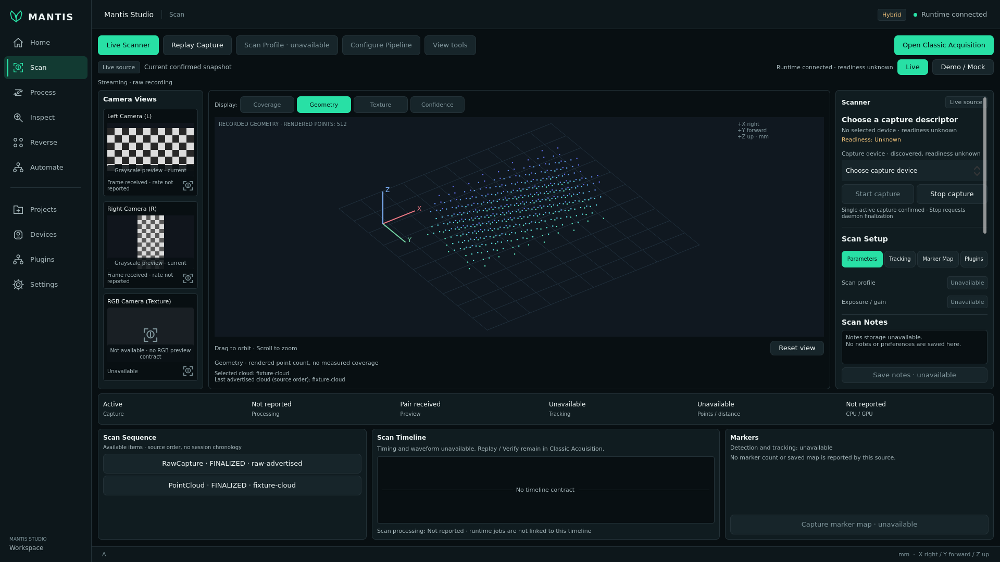
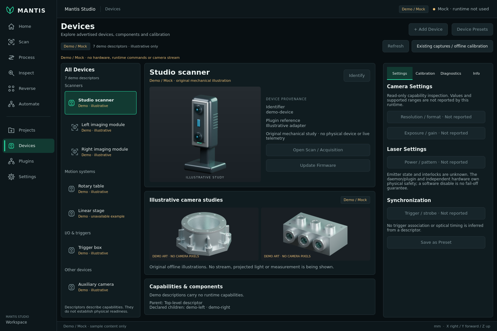

<div align="center">

<h1>Mantis Studio</h1>
<p><strong>An open-source platform for 3D acquisition, processing and visualization.</strong></p>

[](https://github.com/martinkoenig/mantis-studio/actions/workflows/build.yml?query=branch%3Adevelop)
[](LICENSE)
[](https://isocpp.org/)
[](https://www.qt.io/development/qt-framework)

[Get started](#getting-started) · [Development status](#development-status) · [Documentation](#architecture-and-documentation) · [Support development](#support-development)

</div>

Mantis Studio brings device acquisition, recorded data and reproducible processing into a C++23 / Qt 6 platform. It is developed alongside the Mantis X1 handheld laser-scanner project, with an extensible architecture for other devices and custom integrations.



*Actual Qt application capture in **Demo / Mock** mode. Sample projects, scanner artwork, utilization and jobs are illustrative.*

> **In development.** Mantis Studio is not a finished or accuracy-certified scanner. These screenshots show demo content and synthetic fixtures; they are not evidence of a functioning physical laser-scanning workflow, scanner accuracy or production readiness. See [development status](#development-status) for the delivered scope and outstanding gates.

## Platform capabilities

- **Explore and inspect:** Qt Quick workspaces for projects, devices, stereo previews and point-cloud visualization, with explicit mock/live data boundaries and unavailable controls kept disabled.
- **Acquire and replay:** Linux dual-camera acquisition, bounded recording, recoverable segments and deterministic replay. Physical capabilities are qualified separately for the documented hardware and test conditions.
- **Process reproducibly:** typed, immutable artifacts, versioned pipeline recipes, asynchronous jobs, cancellation and traceable calibration/capture provenance.
- **Extend and automate:** device and processing plugins through a versioned C ABI, plus desktop, CLI and C++ / Python SDK clients of the device-owning `mantisd` runtime.

## A closer look

### Projects



*Demo / Mock project gallery and inspector. The sample studies do not represent completed physical scans.*

### Scan



*Actual Qt capture using a deterministic, authenticated client/daemon test fixture. Camera frames, geometry and capture state are synthetic test data, not real-world laser-scanning results.*

<details>
<summary>Devices workspace and screenshot provenance</summary>



*Demo / Mock device descriptors; no physical hardware or laser state is shown.*

All four screenshots are real Qt window captures from [the original UI capture revision](https://github.com/martinkoenig/mantis-studio/commit/f5fefe759f1cfb892604e6e3147656058f7ef2ec). See the [UI implementation and validation notes](docs/ui/README.md) for workflow limits. Mock content is illustrative; fixture data is software-test evidence only.

</details>

## Getting started

This is a developer source build. The reference environment is **Ubuntu 24.04 x86_64 with GCC 13.3 and Qt 6.4.2**; Linux ARM64 also has native CI coverage. Windows x86_64 and macOS ARM64 are architectural targets, **not supported releases**.

### Build and test

You need a C++23 compiler, CMake **3.25+** for the supplied version-6 presets, Ninja, Qt 6 (Base, Declarative and QML runtime modules), Protobuf, SQLite, nlohmann-json, OpenCV **4.6+** (core, imgproc, calib3d and aruco), and Python 3 with `google.protobuf`. CMake 3.24 is sufficient for a manual configuration without presets. See [BUILDING.md](BUILDING.md) for the reference package list and headless/sanitizer instructions; on Ubuntu, also install `libopencv-dev` for calibration.

From the repository root:

```bash
cmake --preset linux-debug -DPython3_EXECUTABLE=/usr/bin/python3
cmake --build --preset linux-debug --parallel 4
ctest --preset linux-debug
```

Keep the executables in `build/debug/bin` alongside their matching `build/debug/plugins` and `build/debug/recipes` directories.

### Explore offline

Launch the illustrative UI without a daemon, token or physical device:

```bash
./build/debug/bin/mantis-studio --ui-mode=mock --workspace=home
```

Mock mode does not connect to `mantisd` or issue capture commands. It is for exploring the interface. See the [UI guide](docs/ui/README.md) for other workspaces and offscreen screenshot options.

### Connect to a local daemon

Run these commands in the **same shell** so the daemon and desktop inherit the same token and port:

```bash
export MANTIS_TOKEN="$(python3 -c 'import secrets; print(secrets.token_hex(24))')"
export MANTIS_PORT=47321
./build/debug/bin/mantisd --project "$PWD/Demo.mantis" &
# Wait for "mantisd ready" before launching the client.
./build/debug/bin/mantis-studio --ui-mode=live --workspace=acquisition
```

The daemon listens on loopback and requires a token of at least 16 characters. This connects to a real runtime; it does not configure physical scanner hardware. The Virtual Scanner provides a synthetic frame-zero recipe/point-cloud/export demonstration; full-capture reconstruction remains a later milestone.

Closing Studio does not stop the daemon or an active capture. After stopping any capture, shut down from the same shell:

```bash
./build/debug/bin/mantis-cli devices list
./build/debug/bin/mantis-cli shutdown
```

For physical acquisition, review the camera/bus assignments and set an explicit `MANTIS_X1_PROFILE` in the daemon environment **before** starting `mantisd`. Follow the [X1/Q6A acquisition procedure](docs/hardware/x1-q6a-acquisition-validation.md) and [acquisition review](docs/architecture/v0.2-acquisition-review.md); requested frame rate, observed rate and physical exposure synchronization are separate claims. [ADR-026](docs/adr/026-bounded-software-observation-pairing.md) defines the bounded software correspondence policy. Test-only fake modes do not qualify hardware.

For automation and extensions, start with the [C++ / Python Client SDK](docs/client-sdk/README.md), [plugin guide](docs/plugin-development/README.md) and [custom sensor guide](docs/plugin-development/custom-sensors.md).

## Development status

The [`develop`](https://github.com/martinkoenig/mantis-studio/tree/develop) branch is the shared development line; `main` is the separate public baseline. Integration acceptance does not automatically accept every source package or qualify physical hardware. The [roadmap](ROADMAP.md) and release documents distinguish independently accepted software, implemented work awaiting review, planned work and hardware-pending capabilities.

| Area | Delivered scope and remaining gates |
| --- | --- |
| Runtime foundation | Daemon, plugins, typed artifacts, jobs, clients and Studio foundation are implemented and independently accepted within their documented scope. |
| Linux acquisition | Dual-OV9281 recording/replay has documented Q6A hardware acceptance. Synchronization, optical exposure skew, sustained external-storage throughput and other physical claims require their own evidence. |
| Geometric calibration | Camera/stereo calibration and Studio workflow are implemented; real-hardware calibration acceptance remains pending. |
| Projected-light acquisition | Software semantics, evidence/storage and hardware-free fixtures have package-specific acceptance. Further qualification is incomplete and physical projected-light enablement remains blocked. |
| Desktop workspaces | Home, Projects, Devices, Scan and Classic Acquisition are implemented. Latest UI corrections retain independent review gates; illustrative content and unsupported actions remain explicitly identified. |

**Not yet delivered as a complete workflow:** production laser-line extraction, metric laser triangulation, moving-scan registration/fusion, meshing and independently validated dimensional accuracy. These remain future roadmap work. Software tests and low calibration residuals do not establish physical scanner accuracy or production readiness.

## Architecture and documentation

`mantisd` owns devices, capture, projects, artifacts, plugins and jobs. The desktop, CLI and SDKs use public client/protocol boundaries. Capture ownership stays with the daemon when a client closes. Plugin SDK and Client SDK responsibilities remain distinct.

| Start here | Reference |
| --- | --- |
| Build, run and contribute | [Build guide](BUILDING.md) · [Contributing](CONTRIBUTING.md) · [Security policy](SECURITY.md) |
| Architecture and implementation | [Architecture authority](ARCHITECTURE.md) · [Frozen v1 specification](MANTIS_STUDIO_ARCHITECTURE.md) · [Implementation map](docs/architecture/implementation.md) · [ADRs](docs/adr/README.md) |
| Release scope and acceptance | [Roadmap](ROADMAP.md) · [Development/review policy](docs/architecture/cut-0c-development-baseline.md) · [Milestone coverage](docs/architecture/milestone.md) · [Validation evidence](docs/architecture/validation.md) |
| Calibration and projected light | [Calibration baseline](docs/architecture/v0.3-geometric-calibration.md) · [Physical calibration validation](docs/hardware/x1-geometric-calibration-validation.md) · [Projected-light package map](docs/architecture/v0.4-laser-acquisition.md) |
| Data and reliability | [Protocol / local data plane](docs/protocol/README.md) · [Storage / recovery](docs/architecture/storage.md) · [Reliability and evidence standard](docs/architecture/reliability-performance-and-validation.md) |
| Product boundaries | [Free / Pro editions](docs/product/editions.md) · [Commercial-module architecture](docs/architecture/commercial-modules-and-licensing.md) |

## Contributing

Contributions to documentation, reproducible bug reports, tests and device integrations are welcome. Read [CONTRIBUTING.md](CONTRIBUTING.md) for architectural boundaries and required validation, and use [GitHub Issues](https://github.com/martinkoenig/mantis-studio/issues) for bugs and feature discussions. Report security concerns through [SECURITY.md](SECURITY.md).

## Support development

If you find the project useful, you can voluntarily help fund its development:

[](https://buymeacoffee.com/martinkoenig)

Prefer another option? [Support via PayPal](https://paypal.me/MartinKoenigDev).

Support is optional. Contributions, testing and feedback are also valuable, and donations do not change the [license](LICENSE) or [Free / Pro boundaries](docs/product/editions.md).

## License

Mantis Studio is licensed under the [Apache License 2.0](LICENSE).
